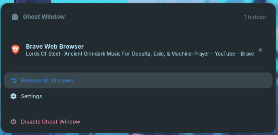

<p align="right">
  <a href="README.md">🇺🇸 English</a> &nbsp;|&nbsp;
  <a href="README.pt-br.md">🇧🇷 Português</a>
</p>

<div align="center">

# 👻 Ghost Window

**Oculte qualquer janela da tela, do Alt+Tab e do Overview — sem fechar o programa.**

[](https://extensions.gnome.org)
[](#)
[](#)
[](LICENSE)

<br/>



</div>

---

## ⚡ Recursos

- **Oculte sob demanda:** Pressione `Ctrl + Alt + J` para esconder a janela em foco imediatamente.
- **🚨 Modo Pânico (Boss Key):** Pressione `Ctrl + Alt + Escape` para ocultar todas as janelas abertas de uma só vez.
- **Segundo plano ativo:** Áudio, downloads e compilações continuam executando silenciosamente.
- **Invisibilidade completa:** Fora do `Alt + Tab`, da barra de favoritos e da visão geral do GNOME (Overview / tecla `Super`).
- **Menu no Painel Superior:** Restaure janelas individualmente, restaure todas ou encerre processos diretamente.
- **Configurações Interativas em Libadwaita:** Clique e pressione as teclas para gravar novos atalhos com detecção nativa.

---

## 🚀 Início Rápido

### 1. Instalação

```bash
git clone https://github.com/edgard-neo/ghost-window.git
cd ghost-window
make install
```

*(Ou simplesmente execute `./install.sh`)*

### 2. Reiniciar o GNOME Shell

- **Wayland:** Encerre a sessão (logout) e faça login novamente.
- **X11:** Pressione `Alt + F2`, digite `r` e tecle `Enter`.

### 3. Ativar a Extensão

```bash
make enable
# ou: gnome-extensions enable ghost-window@ghostwindow.local
```

---

## ⌨️ Atalhos Padrão

| Atalho | Ação |
| :--- | :--- |
| <kbd>Ctrl</kbd> + <kbd>Alt</kbd> + <kbd>J</kbd> | Ocultar janela em foco |
| <kbd>Ctrl</kbd> + <kbd>Alt</kbd> + <kbd>Escape</kbd> | **Modo Pânico:** Ocultar todas as janelas abertas |
| <kbd>Ctrl</kbd> + <kbd>Alt</kbd> + <kbd>K</kbd> | Abrir menu de restauração no painel |
| Clique no **👻** | Abrir menu de restauração no painel |

> **Alterar atalhos:** Abra as preferências com `make prefs` ou `gnome-extensions prefs ghost-window@ghostwindow.local`. Basta clicar no botão do atalho e pressionar as teclas desejadas!

---

## 🛠️ Comandos do Projeto

O repositório inclui um `Makefile` padrão para facilitar o uso e desenvolvimento:

| Comando | Descrição |
| :--- | :--- |
| `make install` | Compila os schemas e instala no diretório de extensões do usuário |
| `make pack` | Gera o arquivo `.zip` para publicação no [extensions.gnome.org](https://extensions.gnome.org) |
| `make enable` | Ativa a extensão |
| `make disable` | Desativa a extensão e restaura todas as janelas |
| `make prefs` | Abre a janela de preferências Libadwaita |
| `make clean` | Remove schemas compilados e pacotes gerados |
| `make uninstall` | Remove a extensão do sistema |

---

## 🔍 Como Funciona

1. **Minimização silenciosa:** Ao acionar o atalho, a janela é minimizada via API do Mutter.
2. **Filtro no Alt+Tab:** O Ghost Window intercepta o construtor `get_tab_list` do GNOME para remover janelas ocultas do alternador.
3. **Exclusão total do Overview:** Intercepta o módulo `Workspace` do GNOME Shell para que janelas ocultas não apareçam nas miniaturas da tela de Atividades.
4. **Bloqueio de atenção:** Impede que apps ocultos reapareçam sozinhos ao emitir notificações de atenção.
5. **Limpeza automática:** Se o aplicativo for encerrado em segundo plano, sua entrada é automaticamente removida do menu.

---

## 📜 Licença

Distribuído sob a licença **GNU General Public License v3.0**. Consulte [LICENSE](LICENSE) para mais detalhes.
